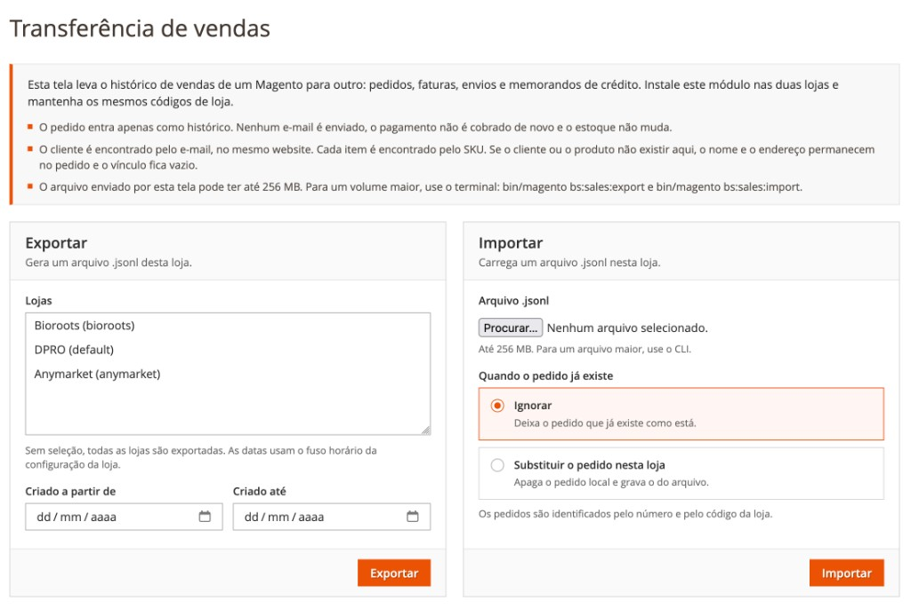

# BS_SalesTransfer

Copy Magento orders, invoices, shipments and credit memos between installations without sending email, charging a payment or changing stock.



## What it does

`BS_SalesTransfer` exports the sales documents of one Magento 2 installation and imports them into another.

- Orders, order items, addresses, payments, status history, taxes, invoices, shipments, shipment tracks, credit memos and their comments travel in one `.jsonl` file.
- An order is matched by **increment id + store code**. The default is to skip an order that already exists. `replace` deletes that order on the destination and writes the copy from the file.
- The customer is linked by email on the same website. A line item is linked by SKU. Guest orders stay guests. Missing customers or products do not stop the import: the snapshot text (name, SKU, address) is kept and the foreign key is left empty.
- Store codes must exist on the destination. Sequences are moved forward so the next local order does not reuse an imported number.
- Rows are written with SQL. Order models are not saved, so observers that send mail, call a payment gateway or change stock do not run.

The file contains personal data (name, email, address, payment metadata). Treat it as a production export.

## Requirements

- Magento Open Source or Adobe Commerce 2.4.x
- PHP 8.1 or newer
- The same module enabled on the source and on the destination

## Install

Copy this directory to `app/code/BS/SalesTransfer`, or install it with Composer:

```bash
composer require brunasebold/module-sales-transfer
```

Then enable it:

```bash
bin/magento module:enable BS_SalesTransfer
bin/magento setup:upgrade
bin/magento cache:flush
```

In production mode, run `bin/magento setup:di:compile` after enabling the module.

## Admin

**Sales > Sales Transfer** (`Vendas > Transferência de vendas` with `pt_BR`).

The upload limit in the admin is 256 MB. Larger files belong on the CLI.

Permissions, under **Sales**:

| Resource | Allows |
| --- | --- |
| Sales Transfer | Open the screen, export and import |
| Export orders | Export only |
| Import orders | Import only |

## CLI

Dates are calendar days in the store timezone (`YYYY-MM-DD`).

```bash
bin/magento bs:sales:export --file=var/export/orders.jsonl --store=default --from=2024-01-01 --to=2024-01-31
bin/magento bs:sales:import --file=var/export/orders.jsonl
bin/magento bs:sales:import --file=var/export/orders.jsonl --behavior=replace
```

`--store` can be repeated. Without it, every store view is exported.

## What is not copied

Configuration, payment credentials, quotes, invoices PDF files, and product images. A payment transaction is copied as data; nothing is captured or refunded. Links between edited orders (`relation`) are restored only when both orders are in the same file.

## Tests

The unit tests cover the file format, validation and permission rules. They do not boot Magento, so they run without `repo.magento.com` credentials.

```bash
phpunit -c phpunit.xml.dist
phpcs
```

GitHub Actions runs both on PHP 8.1, 8.2 and 8.3.

## Author

Bruna Sebold — sebold.bruna@gmail.com

## License

MIT. Copyright (c) 2026 Bruna Sebold. See [LICENSE](LICENSE).
